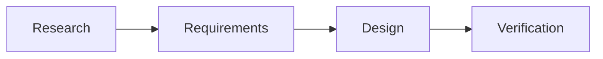

# ChronosHFT

Research, architecture and engineering documentation for a proposed Rust financial time-series database and analytics engine.

The documentation follows the repository and document layout in [the research review and documentation development plan](research/ChronosHFT-Research_Review_and_Documentation.md). Apache Arrow Flight, DataFusion, Arrow and Parquet are the proposed architectural foundation.

**Status:** Research & governance is populated from the [unified Phase 0 assessment](research/ChronosHFT-Phase-0-Research-Baseline-Assessment.md), with extraction, validation, gaps, conflicts, decisions, performance profiles and readiness gates. Product is populated from the supplied Phase 2 drafts, including market/FDAP context, requirements, architecture, MVP scope, traceability, decision handoff and readiness. Architecture and Engineering are populated from the supplied [42-page research PDF](docs/assets/research/HFT-Research-Notes.pdf) and companion Product/Architecture docs, including subsystem contracts, schemas, financial semantics, client integration and validation traceability. Product and engineering approval remain pending; proposals and performance targets are not verified results. Roadmap now contains a proposed implementation plan, MVP delivery gates and milestone registry. Other topic pages remain draft outlines.

## Documentation layout

The Technical Validation Lab presents generated experiment/test registers, individual investigation pages and separate execution, evidence and result views. Its [methodology](docs/10-validation-lab/methodology.md) explains how the structured records extend the historical research assessment.

| Directory | Content |
| --- | --- |
| `docs/00-governance/` | Research baseline, assessment, assumptions, decisions and traceability |
| `docs/01-product/` | Market/FDAP context, requirements, architecture, MVP scope and Phase 2 handoff |
| `docs/02-architecture/` | System architecture, platform design, contracts and data flow |
| `docs/03-engineering/` | Engineering requirements, design and subsystem contracts |
| `docs/04-rust/` | Rust fundamentals, ownership, concurrency and reference exercises |
| `docs/10-validation-lab/` | Generated validation coverage, experiments, tests, executions, evidence and results |
| `docs/05-financial-domain/` | Protocols, timestamps, sequencing, order books and query semantics |
| `docs/06-benchmarking/` | Methodology, workloads, tests, hardware and acceptance criteria |
| `docs/07-operations/` | Deployment, observability, security and recovery |
| `docs/08-decisions/` | Architecture decision records |
| `docs/09-roadmap/` | Implementation roadmap, MVP delivery plan and milestone registry |

`examples/` and `benchmarks/` remain reserved for later engineering work. Validation schemas live under `validation/schemas/`; `tests/` contains registry and documentation regression checks.

## Local preview

Install [uv](https://docs.astral.sh/uv/getting-started/installation/). The project pins Python 3.12 in `.python-version`; uv manages Python and the local `.venv` automatically:

```bash
uv sync --locked --extra docs --extra validation
uv run --locked --extra docs mkdocs serve
```

On Linux, if `uv` is installed in `~/.local/bin` and your shell cannot find it, run `export PATH="$HOME/.local/bin:$PATH"` (and add it to your shell configuration for future sessions).

Open <http://127.0.0.1:8000>. The local server reloads when documentation changes.

Run the same complete gate used in CI:

```bash
uv run --locked --extra docs --extra validation python scripts/check_documentation.py
```

Generated output goes to `site/`, which is ignored by Git. Commit `uv.lock` so local builds and GitHub Actions use the same dependency versions. After editing dependencies in `pyproject.toml`, run `uv lock` and `uv sync --locked --extra docs`.

## GitHub Pages publication

The expected site URL is <https://mbellary.github.io/chronoshft/> after the first successful deployment.

1. In [repository Settings → Pages](https://github.com/mbellary/chronoshft/settings/pages), set **Build and deployment → Source** to **GitHub Actions**.
2. Commit and push the documentation changes to `main`.
3. Watch the **Documentation** workflow in [GitHub Actions](https://github.com/mbellary/chronoshft/actions/workflows/documentation.yml).
4. Open the deployment URL reported by the `github-pages` environment.

The workflow checks relevant pushes and pull requests, including registry, schema, generator and test changes. Pull requests run the full documentation/registry gate; deployment runs from `main` on push or manual dispatch. Publication requires valid registry coverage, current generated pages/navigation, passing regressions, a strict MkDocs build and valid rendered local links/anchors. The deployment job uses GitHub's Pages artifact workflow and scoped `pages: write` and `id-token: write` permissions; no personal access token or `gh-pages` branch is required.

If Pages has not been enabled, or environment protection requires approval, the deployment will wait or fail until the repository settings are resolved. You can rerun the workflow using **Run workflow** after setup. Follow [GitHub's custom workflow documentation](https://docs.github.com/en/pages/getting-started-with-github-pages/using-custom-workflows-with-github-pages) for repository configuration.

## Authoring

Validation metadata and schema checks are documented in [the validation registry guide](validation/README.md). Run those checks when editing `validation/` or the historical research register; a successful documentation build alone does not verify registry consistency.

After changing registry metadata, regenerate with `uv run --locked --extra docs --extra validation python scripts/generate_validation_docs.py`, review the output and run the complete gate. The [automation guide](docs/10-validation-lab/automation-and-ci.md) describes the checks and their publication boundary. Documentation regression checks are separate from the planned experiment tests and create no validation approval.

The [execution and evidence guide](docs/10-validation-lab/execution-and-evidence.md) covers pinned capture, manual import/recovery, retained artifacts and human decision registration. The gate verifies Git-baseline immutability, artifact integrity and recorded decision coverage. The manually dispatched capture workflow retains failures without pushing records or granting approval; EXP-001 now has a ready plan at `validation/execution-plans/EXP-001.yaml` and an isolated Rust prototype under `experiments/exp-001-spsc-queue/`. See its README for the capacity contract and local test command.

Edit the Markdown pages under `docs/` and keep navigation in `mkdocs.yml` synchronized. Preserve source claims, proposed improvements and approved decisions separately. Link requirements and designs to their research, tests and benchmark evidence.

The site includes search, responsive navigation, light and dark themes, code-copy controls and [Mermaid diagrams](https://squidfunk.github.io/mkdocs-material/reference/diagrams/):

````markdown

````

Every topic starts with its purpose, planned coverage, source dependencies and a review checklist. Replace draft outlines as evidence and reviewed specifications become available.
