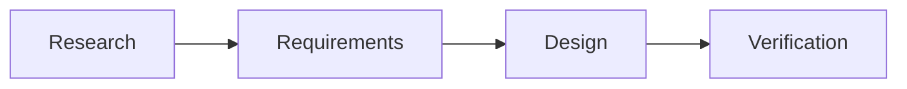

# ChronosHFT

Research, architecture and engineering documentation for a proposed Rust financial time-series database and analytics engine.

The documentation follows the repository and document layout in [the research review and documentation development plan](research/ChronosHFT-Research_Review_and_Documentation.md). Apache Arrow Flight, DataFusion, Arrow and Parquet are the proposed architectural foundation.

**Status:** documentation foundation. Topic pages contain draft outlines, not approved specifications. `research/HFT-Research-Notes.pdf` is still an empty placeholder and must be replaced before original PDF claims or citations can be verified.

## Documentation layout

| Directory | Content |
| --- | --- |
| `docs/00-governance/` | Research baseline, assessment, assumptions, decisions and traceability |
| `docs/01-product/` | Product requirements, architecture and MVP scope |
| `docs/02-architecture/` | System architecture, platform design, contracts and data flow |
| `docs/03-engineering/` | Engineering requirements, design and subsystem contracts |
| `docs/04-rust/` | Rust fundamentals, ownership, concurrency and reference exercises |
| `docs/05-financial-domain/` | Protocols, timestamps, sequencing, order books and query semantics |
| `docs/06-benchmarking/` | Methodology, workloads, tests, hardware and acceptance criteria |
| `docs/07-operations/` | Deployment, observability, security and recovery |
| `docs/08-decisions/` | Architecture decision records |
| `docs/09-roadmap/` | Implementation roadmap and milestone register |

`schemas/`, `examples/`, `benchmarks/` and `tests/` are reserved for later engineering work.

## Local preview

Install [uv](https://docs.astral.sh/uv/getting-started/installation/). The project pins Python 3.12 in `.python-version`; uv manages Python and the local `.venv` automatically:

```bash
uv sync --locked --extra docs
uv run --locked --extra docs mkdocs serve
```

On Linux, if `uv` is installed in `~/.local/bin` and your shell cannot find it, run `export PATH="$HOME/.local/bin:$PATH"` (and add it to your shell configuration for future sessions).

Open <http://127.0.0.1:8000>. The local server reloads when documentation changes.

Build with the same strict validation used in CI:

```bash
uv run --locked --extra docs mkdocs build --strict
```

Generated output goes to `site/`, which is ignored by Git. Commit `uv.lock` so local builds and GitHub Actions use the same dependency versions. After editing dependencies in `pyproject.toml`, run `uv lock` and `uv sync --locked --extra docs`.

## GitHub Pages publication

The expected site URL is <https://mbellary.github.io/chronoshft/> after the first successful deployment.

1. In [repository Settings → Pages](https://github.com/mbellary/chronoshft/settings/pages), set **Build and deployment → Source** to **GitHub Actions**.
2. Commit and push the documentation changes to `main`.
3. Watch the **Documentation** workflow in [GitHub Actions](https://github.com/mbellary/chronoshft/actions/workflows/documentation.yml).
4. Open the deployment URL reported by the `github-pages` environment.

The workflow builds on relevant pushes and pull requests. Pull requests validate documentation only; deployment runs from `main` on push or manual dispatch. Builds must pass `mkdocs build --strict` before publication. The deployment job uses GitHub's Pages artifact workflow and scoped `pages: write` and `id-token: write` permissions; no personal access token or `gh-pages` branch is required.

If Pages has not been enabled, or environment protection requires approval, the deployment will wait or fail until the repository settings are resolved. You can rerun the workflow using **Run workflow** after setup. Follow [GitHub's custom workflow documentation](https://docs.github.com/en/pages/getting-started-with-github-pages/using-custom-workflows-with-github-pages) for repository configuration.

## Authoring

Edit the Markdown pages under `docs/` and keep navigation in `mkdocs.yml` synchronized. Preserve source claims, proposed improvements and approved decisions separately. Link requirements and designs to their research, tests and benchmark evidence.

The site includes search, responsive navigation, light and dark themes, code-copy controls and [Mermaid diagrams](https://squidfunk.github.io/mkdocs-material/reference/diagrams/):

````markdown

````

Every topic starts with its purpose, planned coverage, source dependencies and a review checklist. Replace draft outlines as evidence and reviewed specifications become available.
