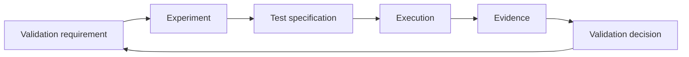

# Technical validation framework

!!! info "Stage 2 framework contract · 2026-10-15"
    This specification defines the contract for registry and tooling work. It records no executed experiment, accepted validation or architecture approval. The [registry migration](validation-registry.md) preserves the research baseline; the [Stage 8 runtime](../10-validation-lab/execution-and-evidence.md) provides capture and verification. Named human approval remains explicit.

## Purpose and authority

Separate the technical question, investigation plan, test specification, observed result and reviewed conclusion. Every conclusion must be traceable to the evidence and implementation boundary that supports it.

The [technical validation register](technical-validation.md) remains authoritative for the Phase 0 findings and required closure evidence for VAL-001–VAL-028. Preserve all original assessments and source references. New engineering records extend those findings without replacing them.

| Authority | Responsibility |
| --- | --- |
| Research & governance | Historical findings, validation objectives, evidence requirements and validation decisions |
| [Technical Validation Lab](../10-validation-lab/index.md) | Experiment definitions, tests, executions, evidence and readable results |
| [Benchmarking & validation](../06-benchmarking/benchmark-methodology.md) | Shared measurement standards, workload contracts and product acceptance criteria |
| [Decision register](decision-register.md) and architecture decisions | Reviewed architecture choices and their effective versions |

The [Stage 3 YAML registries](validation-registry.md#authority-boundary) are authoritative for current engineering metadata following the checked baseline migration. The historical research register remains authoritative for original findings. Stage 6 generates the [Lab views](../10-validation-lab/index.md) from those records, including coverage, registers, results and individual experiment pages. Do not create a second manually maintained status register.

An experiment passing, a validation being accepted and a product benchmark being achieved are separate conclusions. None automatically approves an architecture decision or closes a product release gate.

## Validation hierarchy and relationships

The diagram shows traceability, not a one-to-one tree. Relationships must use explicit IDs and revisions rather than relying on directory names or Markdown links.

| Record | Meaning and required relationship |
| --- | --- |
| Validation | A durable technical question with source references, objective and required closure evidence; may require multiple experiments |
| Experiment | A bounded investigation with falsifiable hypotheses; references one or more validations |
| Test | An independently verifiable procedure with an oracle; belongs to one experiment and references its hypotheses |
| Execution | An immutable observation of one experiment revision and the test revisions attempted in one environment |
| Evidence | An identifiable artifact or documentary review with provenance and an integrity digest; may support multiple decisions |
| Validation decision | A reviewed conclusion for one validation revision, referencing the exact executions and evidence considered |

An experiment may support multiple validations. Each validation must declare which linked experiments, tests and evidence requirements are mandatory for its own conclusion. A shared experiment's success does not establish coverage of every linked validation. Evidence reused elsewhere must have an explicit relevance and applicability explanation.

A test belongs to one experiment to avoid conflicting definitions; other experiments may cite its evidence. Hypotheses describe claims that can be disproven. Documentary investigations use reproducible review procedures, source versions and explicit oracles where executable tests are inappropriate. They still require execution and evidence records.

Define experiments before their tests, and define test procedures, oracles and acceptance criteria before execution. Exploratory observations may inform a later specification; they cannot be relabeled retrospectively as a predeclared test pass.

## Identity and revision rules

| Identifier | Scope and rule |
| --- | --- |
| `VAL-NNN` | Existing validation namespace; preserve VAL-001–VAL-028 and allocate any later IDs without reuse |
| `EXP-NNN` | Repository-wide experiment identity, independent of VAL numbering |
| `TST-NNN` | Repository-wide test identity, independent of crate and function names |
| `HYP-NNN` | Hypothesis identity scoped to an experiment; references include the experiment ID and revision |
| `RUN-<token>` | Repository-wide unique execution ID; token uses letters, digits and hyphens |
| `EVD-<token>` | Repository-wide unique evidence ID using the same token rule |
| `VDEC-NNN` | Validation decision identity; distinct from the existing architecture `DEC` and `ADR` namespaces |

Numbered IDs use at least three digits and grow beyond 999 without reusing numbers. Allocate monotonically within each repository-wide numbered namespace; gaps are permitted. Do not infer coverage, order or record counts from numbering. No EXP or TST assignments are established by this specification.

Validation, experiment and test records start at integer revision 1. Increment the revision when objectives, hypotheses, coverage obligations, procedure, oracle, thresholds, implementation boundary or other definition fields change. CI conservatively requires a revision for wording edits in YAML definition fields; formatting and authored-document presentation changes leave the parsed definition unchanged. Preserve the previous definition through version history and a dated change reason. Retain a full snapshot under `validation/revisions/{validations,experiments,tests}/<ID>/r<revision>.yaml` before incrementing; this also preserves definitions during uncommitted staged work. Snapshots are historical definitions rather than duplicate current records.

Human-facing links may show the latest record. Execution and decision references must identify the exact record ID, revision and registry source commit. Where implementation and registry commits differ, record both. Record hashes for fixtures, lockfiles and external inputs as applicable. A revision number alone cannot establish which source was executed.

RUN, EVD and VDEC records are immutable after registration. Corrections create new records with explicit supersession links and reasons; retain the originals. An artifact digest or URI change requires a new evidence record. Never edit a failed execution into a passing one. Content hashes detect changed content; retained storage and access controls are also required to preserve it.

## Minimum record contracts

These semantic requirements are represented by schemas under `validation/schemas/`. Stage 4 populates experiment definitions and their validation relationships; Stage 5 refines the previously unpopulated test schema and adds the [test catalog](../10-validation-lab/test-register.md). Execution, evidence and decision records remain pending; specifications do not establish that an investigation has executed.

| Record | Required content |
| --- | --- |
| Validation | ID/revision; preserved research provenance and assessment; engineering objective; category/priority; required evidence; mandatory coverage; lifecycle; current decision reference, if any |
| Experiment | ID/revision; linked validations; objective; hypotheses; scope and exclusions; implementation or documentary method; dependencies; tests; completion criteria; lifecycle |
| Test | ID/revision; owning experiment, scoped hypothesis and applicable validation references; classification; automated or manual method; mandatory status; setup; procedure; expected result; independent oracle; execution method and binding; required evidence |
| Execution | ID; UTC start/end timestamps; working directory; experiment/test revisions; per-case outcomes, argument arrays, exit codes, durations and evidence IDs; exact procedure; implementation/registry commits; dirty/change-during-run state and patch if applicable; lockfile hashes; actual toolchain/OS/CPU/configuration; inputs/seeds/instrumentation; artifacts; failures, skips and tool errors |
| Evidence | ID; kind; producing execution or documentary provenance; immutable artifact reference; SHA-256 digest; size and media type; retention/access location; supported requirement or claim scope |
| Validation decision | ID; validation revision; disposition; rationale; execution/evidence references; coverage and requirement-by-requirement evidence assessments; unresolved findings; applicability boundary; named reviewer and review timestamp; architecture/specification actions; superseded decision, if any |

Environment details must capture factors relevant to reproduction: compiler/build flags and enabled features for executable tests; CPU, memory topology, affinity and workload for performance; source edition/version, retrieval date and archived content for documentary review. A future environment profile may be reused, but each run must pin its version and record deviations.

Preserve the existing [engineering evidence contract](../03-engineering/validation-and-traceability.md#requirement-to-executable-evidence-contract) and [benchmark evidence bundle](../06-benchmarking/evidence-and-traceability.md#proposed-evidence-bundle). The [execution workflow](../10-validation-lab/execution-and-evidence.md) maps `evidence/<run-id>/` bundles to immutable manifests and retained artifacts. Small content-addressed assets may be retained in Git; large data uses a separate bundle/mirror. A manifest alone does not establish accessibility; the evidence gate checks actual content.

## State and outcome model

Keep the historical research assessment, engineering lifecycle and technical disposition separate. Preserve research labels verbatim, including qualifiers such as “Validated (role only)”; do not normalize them into engineering acceptance.

### Validation lifecycle

| State | Meaning | Permitted next states |
| --- | --- | --- |
| `identified` | Technical question captured; execution plan incomplete | `planned` |
| `planned` | Required investigation and coverage declared | `ready` |
| `ready` | Required definitions, prerequisites, methods and environment are available | `running`, `planned` |
| `running` | Evidence collection has started | `reviewing`, `planned` |
| `reviewing` | Evidence and coverage are being assessed | `closed`, `running`, `planned` |
| `closed` | A reviewed accepted, conditional or rejected decision has been recorded | `reopened` |
| `reopened` | Prior conclusion needs reassessment for an identified change or finding | `planned` |

Every transition records its date, actor and reason; backward transitions explain missing prerequisites or remediation. State changes cannot substitute for evidence. `running` means an investigation is underway, not necessarily that a process is currently executing. Reopening preserves the historical decision and identifies the scope where it no longer establishes current acceptance.

An inconclusive decision leaves the validation in `reviewing`, or moves it to `planned` when new investigation is specified. It cannot close a validation. A closed rejection resolves the technical question negatively and must link the required engineering action; it does not imply release readiness. Conditional closure requires an explicit supported envelope and tracked follow-up obligations.

### Experiment lifecycle and execution outcomes

Experiments use `proposed` → `ready` → `running` → `reviewing` → `completed`. Readiness requires defined tests, oracles, prerequisites and an executable or documentary method. Review may return an experiment to `running` for more evidence or to `proposed` for redesign; a ready experiment may return to `proposed` if prerequisites change. Definition changes follow the revision rules. A completed investigation needing more work starts a new revision in `proposed`, preserving prior results.

Stage 5 tests explicitly record `execution_binding.state` as `unbound` until a concrete command or manual review checklist is prepared. A bound method needs an entrypoint; bound automation also needs an implementation path. All mandatory tests must be bound before an experiment advances beyond `proposed`. Binding does not execute a test or verify prerequisites by itself; relevant source/fixture revisions, approved contracts, budgets and environments must still be fixed and reviewed. Current methods remain unbound.

`--require-tests` in the register checker requires mandatory tests for every hypothesis, the declared documentary/executable method mix and every linked validation. Validation and test applicability references are reciprocal and revision-pinned. A shared experiment may have a test that applies to only one validation; reusing its other tests does not broaden that test's scope.

`completed` means its required investigation has been performed and reviewed, including a supported negative result. It does not mean every hypothesis was confirmed. Tests are versioned specifications; their outcomes belong to executions.

Each attempted test records `passed`, `failed`, `skipped` or `error`. A failed assertion is `failed`; an infrastructure or tool failure that prevents a valid observation is `error`; an unattempted case is `skipped` with a reason. An interrupted execution is recorded as `aborted`, retaining available per-test outcomes. For other executions, the aggregate is `error` if any test errored, otherwise `failed` if any test failed, otherwise `incomplete` if any declared test was skipped or omitted, otherwise `passed`. A run with no test outcomes cannot pass.

Evidence has provenance and integrity checks, not a technical pass/fail status of its own. Failed and inconclusive observations remain evidence. Decisions evaluate what that evidence demonstrates.

## Dispositions and closure

The current technical disposition is `pending` until a reviewed decision exists for the current scope. It is then derived from the referenced decision: `accepted`, `rejected`, `conditional` or `inconclusive`. Reopening sets the disposition for the changed scope to `pending` while retaining the prior decision and its historical disposition. Do not independently edit a disposition in a Markdown table.

Accepted closure requires all of the following:

1. Every mandatory evidence requirement and linked experiment/test obligation is addressed for the validation revision under review.
2. Required acceptance tests have valid passing results for the applicable implementation, inputs and environment; no mandatory test is skipped or errored. Earlier failed runs are retained, and their resolution is explained.
3. No unresolved critical finding invalidates the conclusion. Narrow evidence, including sequential FIFO tests, is not promoted into a broader safety or performance proof.
4. Evidence is retrievable and its provenance, hashes, source revisions and applicability are checked.
5. A named designated reviewer records an explicit decision with rationale, scope and review date. An automated check may support review but cannot invent approval.
6. Affected architecture decisions and engineering specifications are updated or linked, with any separate approval still explicit.

Other dispositions require distinct conclusions:

| Disposition | Required decision content |
| --- | --- |
| `conditional` | Evidence supporting the accepted envelope; exact workloads, hardware, dependency versions, exclusions and limits; unresolved obligations with responsible owners and review conditions. An invalidating critical finding cannot be waived without narrowing the envelope and supporting that boundary |
| `rejected` | What was disproven, evidence supporting the negative conclusion and the subsequent engineering/remediation action; passing all acceptance tests is not required to establish rejection |
| `inconclusive` | What remains unresolved, why the evidence is insufficient and the next investigation needed; no closure |

The record author maintains the investigation and traceability. The executor records observations accurately. The designated reviewer assesses coverage, evidence and conclusions. Architecture/product owners retain their existing decision responsibilities. These are responsibilities, not assigned people; no named reviewer or approval is created by this document.

## Revalidation and applicability

A decision applies only to its recorded implementation, workload, environment and assumptions. Preserve the approved decision even when a later revision needs revalidation; show its historical scope alongside the current pending assessment.

Assess impact when any of these changes:

- Source code, APIs, algorithms or concurrency behavior affecting tested invariants.
- Compiler, dependency, feature or build configuration relevant to the conclusion.
- Component contracts, schema, financial semantics, failure model or acceptance criteria.
- Workload, input distribution, hardware, operating system or topology relevant to measured behavior.
- New findings, contradictory evidence or unavailable/corrupted supporting artifacts.

Record the changed inputs, affected VAL/EXP/TST references, prior decision, impact rationale and selected revalidation work. Reopen affected closed validations when their conclusion no longer covers the changed scope. Unaffected historical evidence remains available. A newer passing run cannot silently replace the reviewer-selected decision.

Use explicit dependency and impact mappings to choose checks. Documentation-only edits that change no contract or claim need documentation checks; semantic changes to thresholds or oracles need technical impact review. Shared CI can establish compilation and correctness observations, while timing-sensitive acceptance needs a declared controlled environment. Critical release regression gates remain mandatory even when impact selection would otherwise omit them.

## Delivery boundary and next stage

Stage 2 established the specification and its documentation links without allocating experiment IDs or asserting executions or approvals.

The [Stage 3 migration](validation-registry.md) preserves historical findings and defines the checked authority boundary. The [coverage plan](../10-validation-lab/validation-coverage.md) and [test definitions](../10-validation-lab/test-register.md) declare investigations and bindings. Stage 8 adds the [runtime and review workflow](../10-validation-lab/execution-and-evidence.md) and extends CI with history/evidence verification. Execution/decision schema v1 is refined before its first real records. No existing validation/test definition, lifecycle or decision is advanced by this infrastructure. Stage 9 implements EXP-001 and collects its first real observations.
