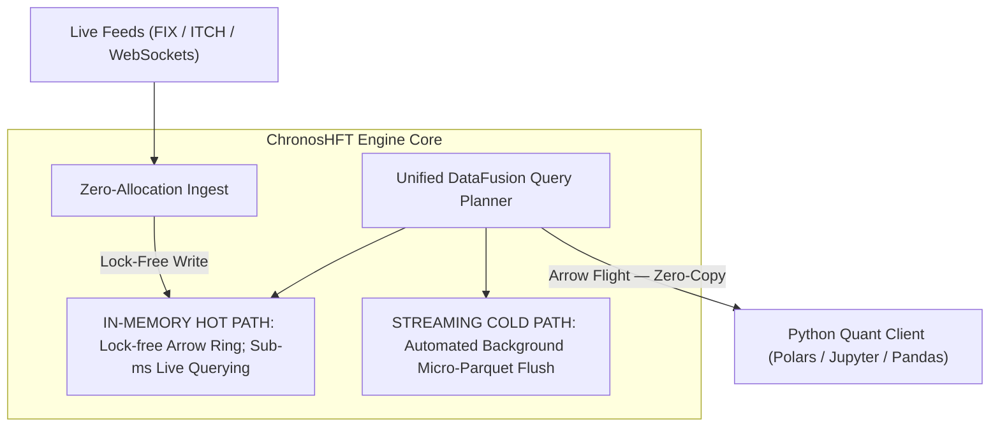

# ChronosHFT — Product Architecture Document

| Control | Value |
| --- | --- |
| Document | DOC-03 / CHRONOS-P2-ARCH-001 |
| Version / date | 1.0 / 2026-10-13 |
| Status | Product architecture draft; scope and engineering decisions pending |
| Inputs | BASE-001, Phase 0 CHRONOS-P0-001; [PRD](product-requirements.md) |
| Companions | [Scope and MVP](scope-and-mvp.md); [Phase 2 handoff](phase-2-definition.md) |

## 1. Responsibility and authority

This document maps user capabilities, product boundaries and external interactions. It does not authorize algorithms, unsafe code, thread layouts or durability mechanisms. BASE-001 is the unchanged 42-page HFT - Research Notes.pdf identified by the PRD hash. Physical PDF page references and Phase 0 RES/DEC/GAP IDs provide provenance. The FDAP/single-node direction is source-established; realization details remain proposals. Phase 1 completion is user-reported; repository integration is a handoff rather than a claim of changes to an unseen repository.

## 2. Product context and boundary

The working product is a financial TSDB: market-data sources supply events; ChronosHFT exposes recent/historical analytics to SQL and Python users; the customer operates a private node. Strategies, notebooks, trading/risk applications and exchange matching engines sit outside this proposed boundary. DEC-001 remains open because the research also mentions order-routing/strategy consumers and earlier edge/IoT markets.

The diagram is a product interpretation of pp. 15–16, not a thread/process design. Arrows describe responsibility and data access, not timing, acknowledgments or transactional guarantees.

## 3. Capability register

| Capability | User-visible responsibility | PRD links | Source / boundary |
| --- | --- | --- | --- |
| CAP-01 Feed capture | Receive supported feeds and expose declared event types | F01/F02; N01/N06 | pp. 16, 26; RES-024/025/027; coverage pending |
| CAP-02 Recent-data access | Query published events while capture continues | F03; N02/N03/N08 | pp. 16, 26–27; RES-016/017/029; freshness pending |
| CAP-03 Financial SQL | Standard query subset, ASOF matching, bucketing/OHLCV | F04/F05/F06 | pp. 6, 16–17, 28; RES-010/011/028; exact semantics pending |
| CAP-04 Historical storage | Preserve and expose historical events in Parquet | F07; N07/N09 | pp. 9, 16, 27; RES-018/023; commit/recovery pending |
| CAP-05 Unified analysis | Query across recent and historical data | F08; N08 | pp. 16, 27; RES-019/047; handoff consistency pending |
| CAP-06 Correction-aware history | Apply late/corrected data and query as-known state | F09/F10 | pp. 17, 27–28; RES-012/030/049 |
| CAP-07 Research access | Typed Flight results and Python dataframe workflows | F11 | pp. 17, 27–28; RES-013; API and compatibility pending |
| CAP-08 Time fidelity | Preserve source precision using ns representation | F12 | pp. 23–26; RES-040; resolution is not ordering |
| CAP-09 Private operation | Run customer-controlled deployment without runtime Internet dependency | N04/N05/N06/N07 | p. 17; RES-015; controls are derived candidates |
| CAP-10 Book reconstruction | Optional timestamped L1/L2/L3 analysis | F13 | p. 10; RES-021; candidate extension, not approved core |

PRD references use the `PRD-` prefix: F01 means PRD-F01; N01 means PRD-N01.

## 4. Logical product surfaces

| Surface | Incoming interaction | Observable result | Open contract |
| --- | --- | --- | --- |
| Feed adapter | Venue/fixture events | Declared normalized events or declared errors | Protocol/version, entitlement, recovery, gaps, duplicates |
| Query interface | SQL plus temporal/correction options | Typed results or explicit failure | Dialect, parameterization, cancellation, errors and isolation |
| Python/Flight interface | Remote query and result consumption | Supported Arrow/dataframe representation | Flight RPC/API shape, auth, type fidelity, copy/conversion limits |
| Historical-data access | Read/export persisted datasets | Open-format historical access | Catalog metadata, schema evolution and correction visibility |
| Operator surface | Configure/start/stop/inspect node | Declared status and configuration outcome | CLI/API/UI shape, metrics, drain and recovery procedures |

These are logical contracts, not an assertion that all corresponding APIs exist. Operator features are derived from deployment needs and require product review. No REST endpoint, Flight SQL support, subscription API or multi-tenant service is silently added.

## 5. FDAP responsibilities and extension boundaries

| Foundation | Research role | ChronosHFT product responsibility | Unsettled engineering boundary |
| --- | --- | --- | --- |
| Arrow | In-memory columnar data | Typed recent data and interchange | Ownership, buffers, schema and precision |
| DataFusion | SQL planning/execution | Financial query behavior and hot/cold access | Custom provider/planner/operator selection and dependency pins |
| Parquet | Historical columnar storage | Open-format persistent history | Commit/catalog, corrections, compaction and recovery |
| Flight | Client result transport | SQL/Python result experience | Serialization/copy boundaries and client contract |
| Rust node | Single-node host | Integrate capture, analytics and persistence | Runtime topology, resource control and lifecycle |

Source: pp. 2, 11–17, 26–28; RES-002/024. Using these foundations does not establish nanosecond latency, allocation freedom, safe recycling or production readiness. The lock-free ring, double buffering, Disruptor, DPDK and core pinning are proposed realizations for DOC-04–07/12, not user-facing capability requirements.

## 6. User journeys and state boundaries

**Live research:** configure a supported feed → receive and normalize events → publish a readable version → execute financial SQL → deliver typed results. Receipt, accepted ingest, query visibility and durable commit are different events. The source does not specify a fixed time between them.

**Historical research:** select instrument/time interval → resolve eligible recent and persisted versions → execute unified query → deliver one result. A correctness contract must exclude gaps/double counting during tier handoff (GAP-007). The five-minute hot window example on p. 27 is illustrative, not a universal retention commitment.

**Correction-aware research:** accept a correction → preserve the approved historical/version semantics → expose current or as-known view. Event time and knowledge time are distinct; timestamp precision cannot substitute for venue ordering or version rules (GAP-006/010/014).

**Failure and restart:** report declared degraded/failed state → apply approved recovery procedure → make recovered visibility explicit. Background Parquet flushing alone does not establish zero loss or an acknowledged commit. WAL/source replay/volatile modes remain DEC-008.

## 7. Deployment and packaging boundaries

The source proposes a single-node Rust binary, self-hosted/private VPC/co-location deployment and Python access. On-node memory and local Parquet/NVMe form the working core. Cloud object storage appears in the high-level research (p. 16) and earlier cloud context (p. 2); whether it enters MVP is pending DEC-002, not an automatic S3 dependency. Runtime external Internet dependency is excluded by source NFR-3, while any chosen external feed still needs venue connectivity.

Fleet management, active-passive replication and support SLAs are future commercial proposals (pp. 17–18). Distributed query, sharding and multi-node consensus are not established MVP capabilities. The EPYC/25–100GbE/DPDK profile is a reference validation configuration, separate from the eight-core MVP target.

## 8. Correctness and trust boundaries

Proposed product expectations to ratify: distinguish accepted from dropped events; disclose feed gaps; avoid precision loss; use declared financial matching rules; preserve query versions during tier transitions; document durability/recovery; enforce approved client and feed access. These originate in Phase 0 gaps, not a completed source security design.

Detailed trust/authentication boundaries, offline dependency bundles, exchange entitlements and administrative permissions go to DOC-13. Financial event schemas, ordering and matching go to DOC-10/11. No regulatory certification, order-execution correctness or investment outcome is promised.

## 9. Architecture acceptance and handoff

Approve this architecture only after DEC-001/002 records fix the product boundary and MVP capability set. Every core capability must map to PRD acceptance intent and a future component contract. DOC-04 will define runtime components and topology; DOC-05 interfaces/lifecycles; DOC-06 measurable engineering contracts; DOC-07 algorithms. They must retain these capability links and resolve open decisions rather than treating the research examples as approved designs.
