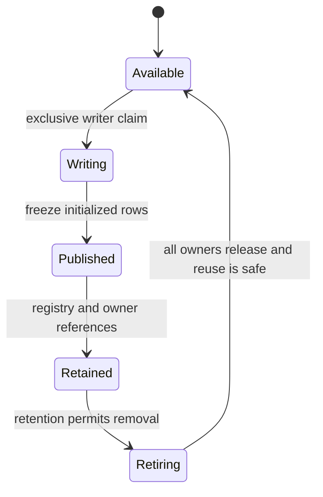

# Active memory and concurrency

!!! info "Source patterns with safety qualifications · 2026-10-14"
    Extracted from [unified HFT research notes](../assets/research/HFT-Research-Notes.pdf), §3.1–3.4, physical pp. 28–42. Rust listings are blueprints requiring version pins and ownership review, not production-ready code.

## Ring-buffer publication

The `HftRingBufferRotator` example allocates Arrow timestamp/price/size builders per slot, uses power-of-two masking, and separates cache-aligned atomic write/read sequences. The writer appends rows and advances the published write sequence with Release ordering; the consumer observes it with Acquire, extracts arrays and advances the read sequence (pp. 29–32; RES-051–053).

The intended discipline is single producer/single consumer. Its public `&self` methods and unsafe `Sync` wrapper do not enforce that discipline. Also, the full-ring test occurs after append; failed rotation leaves the same slot active and permits subsequent appends. **Proposed refinement:** restrict producer/consumer handles, validate nonzero power-of-two size and batch capacity, check availability before writes, and define a bounded exhaustion policy (VAL-012/013; DEC-003/006).

## Freeze, retain and reclaim

This state machine is a proposed design obligation. Immutable Arrow batches can be shared by queries and persistence; mutable builders remain writer-owned. Moving builder storage into arrays and recycling the same storage are different operations. The existing assessment records that builder `finish()` transfers values rather than preserving their allocation in the builder; calling `reserve()` can allocate. Batch destruction does not automatically run a pool-return protocol (VAL-014/020).

Compare two realizations under DEC-003: immutable batch transfer with explicit allocation budgets, or a bounded pool with reader leases and demonstrated reclamation. Neither the source's `Arc` usage nor an atomic cursor proves allocation-free turnover. Include allocation/deallocation and page-fault measurement across append, rotation and reclamation.

## Intra-slot double buffering

The `ConcurrentSplitSlot` pattern holds buffers A/B and flips the active write index. The source suggests freezing every 500 µs or 1,000 rows to improve low-volume freshness (pp. 36–39; RES-058/059). This differs from advancing the outer ring for every publication.

An index flip alone does not enforce exclusive append/flush callers or prove a reader has released storage before reuse. The sample finishes builders into immutable arrays; it does not establish that queries read the same mutable memory being overwritten. **Proposed refinement:** let one writer own append and flip; send timer requests to that writer; track generation/ownership and outstanding batches separately. A buffer is reusable only under the approved transfer or pool protocol (VAL-019/020).

## Disruptor as batch coordinator

The source uses Disruptor to publish whole-batch readiness rather than individual ticks. `ArrowBatchReadyEvent` carries a slot index and optional frozen `RecordBatch`; a BusySpin consumer is intended to feed the DataFusion registry (pp. 39–42; RES-060–062). The shown callback only prints row counts, so the registry integration is still missing.

A Disruptor sequence protects its event slots until the relevant consumers advance. If a callback hands a batch to a later query, callback completion is not query completion. Arrow backing-memory retirement needs its own lifetime accounting. Verify the selected crate API, cache layout and wait strategy; sub-100 ns signaling is a source claim, not a measured project result (VAL-021/022).

## Review gates

Before adopting unsafe code, demonstrate exclusive mutation, initialized-before-publication ordering, bounded capacity and delayed-reader-safe reuse. Exercise empty/partial batches, repeated wraparound, slow persistence, cancellation, concurrent scans and exhaustion. Separate queryable retention from the ingestion queue: the example 1,024 × 4,096 configuration is 4,194,304 rows, about 4.19 seconds at 1M ticks/s without drain, not five minutes of retained history.

Related: [platform design](platform-design.md), [contracts](component-contracts.md), [technical validation](../00-governance/technical-validation.md), [performance feasibility](../00-governance/performance-profiles.md).

## Memory visibility boundary

The implementation contract proposed for DEC-003 is **exclusive mutable builders plus immutable batch transfer into a versioned registry published through `ArcSwap`**. This specifies the intended implementation; the repository has no Rust engine yet and DEC-003 remains pending approval. Double buffering may provide writer staging capacity, but it is not the query isolation mechanism. Queries never read an Arrow buffer while the producer writes into that same buffer.

1. One producer owns the mutable Arrow builders. It validates capacity before append, completes every column of a row, and freezes only initialized rows into a `RecordBatch`. After transfer, the backing arrays are immutable; the producer continues with distinct storage.
2. The `disruptor-rs` event carries an owned frozen batch and generation/sequence identity. Release publication and Acquire consumption protect the event payload as specified in [memory ordering](../04-rust/atomics-and-memory-ordering.md#ring-buffer-ordering-contract). The coordinator moves/clones ownership into a new immutable registry snapshot, then publishes that snapshot atomically through `ArcSwap` using its safe API and documented synchronization guarantees.
3. At `TableProvider::scan()`, DataFusion captures an owned registry reference with `load_full()`. The execution plan retains the selected batch references until completion or cancellation. New publications create new registry versions; they do not modify the captured snapshot. A query sees the batches committed at its cutoff, including their fixed row counts, and cannot see an unfinished tick.
4. Retention removes a batch from future snapshots, not from running plans. Arrow backing storage is freed when the last owning reference is dropped. Disruptor consumer advancement frees the notification slot only. It never authorizes reuse of backing arrays still held by DataFusion or persistence.

This transfer design does not promise allocation-free builder rotation or registry updates. An optional pool must require explicit last-reader leases before reuse; an A/B flip or reference-count observation alone is insufficient. Keep registry ownership acyclic, release query references on cancellation, and bound retained bytes, query lifetime and persistence backlog. At the retention budget, enforce admission/backpressure or query cancellation under a declared policy; never overwrite reader-owned storage. Slow-reader, repeated-wrap and cancellation tests must demonstrate both stable batch contents and reclamation after the final owner releases them (VAL-013/014/015/019–021).
