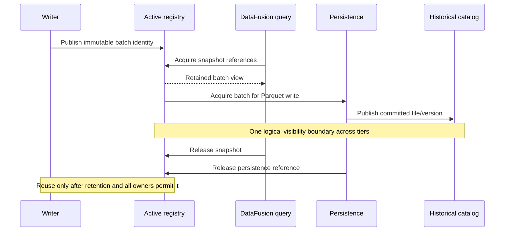

# Data flow

!!! info "Research flow and proposed handoff · 2026-10-14"
    Source: [unified HFT research notes](../assets/research/HFT-Research-Notes.pdf), pp. 8–17, 26–28 and 29–42. Snapshot, commit and retirement steps refine gaps in the examples; they are not source-proven implementation behavior.

## From feed to a readable batch

1. A feed adapter receives FIX, ITCH or WebSocket input and decodes a declared event schema. Preserve venue sequence and timestamp precision; transport/framing and recovery differ by adapter.
2. Apply the selected duplicate/gap/lateness policy and bounded admission check before appending. The roadmap proposes bounded micro-sorting, but its window and beyond-window behavior are unresolved.
3. The exclusive writer appends columns into its current mutable buffer. Queries cannot observe partially appended rows or inconsistent column lengths.
4. On a row threshold or writer-owned timer request, freeze the populated portion and publish a batch-ready notification. Publication ordering makes initialized values visible to the coordinator.
5. The coordinator retains the immutable batch in the active-memory registry. New queries see it under the chosen snapshot/freshness policy.

## Concurrent queries and persistence

This is a proposed lifecycle, not the PDF's consuming `scan()` loop. A query acquires a stable hot/cold view, applies projection/filter/financial operations and streams Arrow results via Flight. Multiple queries must not divide the input queue between them.

## Hot-to-cold handoff

Persistence writes an immutable batch as Parquet, completes the selected durability/commit protocol, and makes its file metadata visible. A query spanning the transition needs one consistent view: it must see an event in eligible hot data or eligible committed cold data exactly once. Capturing unrelated memory and file lists at different instants can create gaps or double counting. Snapshot/catalog versioning is a proposed solution; its mechanism is open (DEC-008/009; VAL-023/024).

Eviction from the hot registry, dropping a query reference and freeing/reusing the allocation are separate operations. A long-running query can retain a batch after later snapshots select its cold representation; that lifetime must be included in the memory budget.

## Publication, flush and retention clocks

| Clock | Source example | Interpretation |
| --- | --- | --- |
| Readable publication | 500 µs or 1,000 rows (p. 36); optional timer with 4,096-row batches (pp. 34–36) | Controls low-volume query freshness; timer is not implemented in the sample |
| Cold flush | 5 seconds or 500,000 ticks (p. 9); 10 seconds or 500,000 ticks (pp. 16, 27) | Conflicting examples require DEC-004; persistence cadence is separate from publication |
| Query scheduling | 10 ms demonstration loop (p. 35); 100 ms Stage 1 gate (p. 27) | Example workload cadences, not a freshness guarantee |
| Hot retention | Five minutes in a one-hour hybrid example (p. 27) | Illustrative window, not ring capacity or approved retention |

## Late data, corrections and recovery

Bounded reordering before publication cannot resolve every late tick or retroactive trade correction. Preserve event time separately from system-knowledge time; define whether queries select current corrected state or an as-known historical version. Correction identity, duplicates and cross-tier updates require explicit semantics (pp. 6–7, 17, 27–28; DEC-009/014).

After a crash, rebuild visibility from the selected durable source and catalog protocol. A volatile-only deployment may lose accepted but uncommitted data; WAL or feed replay alternatives require an approved recovery model. Background writes and NVMe striping alone do not promise zero loss.

Related: [component contracts](component-contracts.md), [query/storage integration](query-and-storage.md), [performance profiles](../00-governance/performance-profiles.md).
