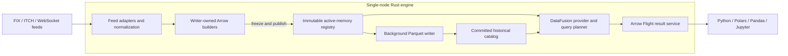

# System architecture

!!! info "Research-derived architecture · 2026-10-14"
    Extracted from the unified [HFT research notes](../assets/research/HFT-Research-Notes.pdf) (BASE-001). This is a design draft, not an implemented system or approved ADR. Physical PDF page numbers identify the source; proposed refinements are labeled separately.

## Runtime boundary

The research converges on a single-node Rust financial time-series database with embedded DataFusion, Arrow active memory, Parquet history and Arrow Flight results. Live feeds supply events; SQL and Python clients consume analytics. Trading strategies and exchange order routing are external consumers, rather than implicitly included database components. Earlier edge/IoT and fleet-management discussion supplies market context, not an additional MVP runtime (pp. 2–13, 15–18; RES-002/024; DEC-001/010).

## Logical topology

The hot/cold/Flight structure follows pp. 8–13 and 15–17. The immutable registry and committed catalog are **proposed refinements** from the existing validation findings: queries must not consume the ingestion queue, and hot/cold visibility needs a consistent handoff. Arrows show responsibility, not guaranteed latency or durable acknowledgment.

## Architectural responsibilities

| Layer | Foundation | ChronosHFT responsibility |
| --- | --- | --- |
| Ingestion | Rust and protocol adapters; optional kernel bypass | Decode, normalize, sequence and admit events within bounded resources |
| Active memory | Arrow; ring/Disruptor coordination candidates | Separate mutable writes from immutable published data; track reader and storage lifetimes |
| Queries | DataFusion | Expose snapshots, route hot/cold scans and define financial extensions |
| Persistence | Parquet | Flush batches, publish catalog metadata, define recovery and correction handling |
| Client transport | Arrow Flight | Return typed Arrow results to supported clients; specify transport and conversion costs |

FDAP provides primitives; active-memory orchestration, hybrid visibility and bounded ingestion remain project work (pp. 11–13). No tracing garbage collector does not prove bounded allocator, paging, destruction or scheduler latency. Flight avoids mandatory JSON/CSV translation but still uses transport and IPC processing (VAL-004/005).

## Architecture guide

- [Platform design](platform-design.md): subsystem ownership, resources and data model.
- [Component contracts](component-contracts.md): interface guarantees and failure responsibilities.
- [Data flow](data-flow.md): publication, querying, persistence and retirement.
- [Active memory and concurrency](active-memory.md): ring, double-buffer and Disruptor patterns.
- [Query and storage integration](query-and-storage.md): custom providers, hybrid catalog and financial semantics.
- [Deployment topology](deployment-topology.md): hardware, core placement and performance profiles.

## Delivery sequence and unresolved decisions

The source roadmap builds the hot path first (months 1–3), then persistence and hybrid routing (4–6), then Flight/Python and financial query extensions (7–9). These are source estimates, not a committed schedule. ASOF appears in the MVP description as well as Stage 3; reconcile delivery scope before implementation (pp. 16, 26–28; DEC-002).

Closure requires decisions on product boundary (DEC-001), ownership (DEC-003), publication/freshness (DEC-004), overload (DEC-006), durability (DEC-008), corrections (DEC-009), hardware (DEC-011) and financial schemas (DEC-014). See the [decision register](../00-governance/decision-register.md), [technical validation](../00-governance/technical-validation.md) and [product architecture](../01-product/product-architecture.md).
