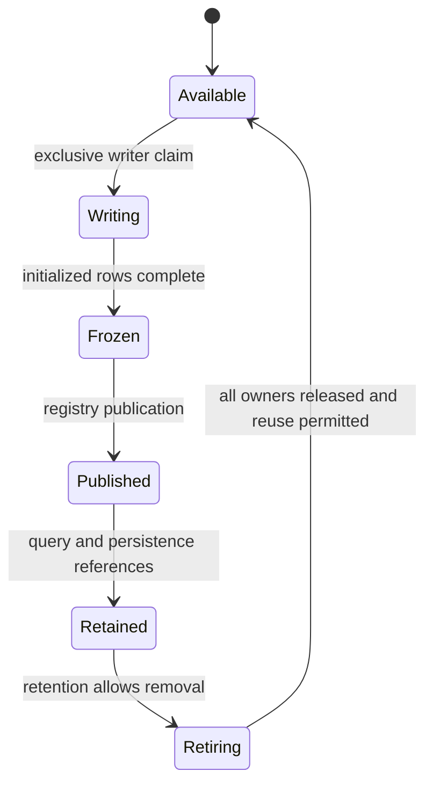

# Active memory lifecycle

!!! info "Research-derived engineering draft · 2026-10-14"
    Based on the [HFT research notes](../assets/research/HFT-Research-Notes.pdf) (BASE-001, physical PDF pages), the [Architecture tab](../02-architecture/system-architecture.md) and [Product requirements](../01-product/product-requirements.md). Source intent, existing validation findings and proposed engineering refinements are distinguished below. No implementation, benchmark result or decision approval is asserted.

## Source patterns and proposed invariant

PDF §3.1–3.4 (pp. 29–42; RES-051–062) proposes an SPSC ring, intra-slot double buffering and Disruptor batch notifications. The Engineering contract is exclusive mutable ownership followed by immutable shared ownership and explicit retirement (ENG-003–006). [Architecture active memory](../02-architecture/active-memory.md) and VAL-012–022 identify missing safety and allocation proofs.

This is a proposed logical lifecycle. Under immutable transfer, returning the builder slot to Available does not mean detached array storage has returned to a pool. Under reusable storage, all retained allocation leases must be released before reuse.

## State obligations

| Boundary | Proposed proof obligation |
| --- | --- |
| Available → Writing | Capacity and generation are valid; exclusive producer handle claims the slot |
| Writing → Frozen | All columns contain exactly the initialized row count; no further mutation through aliases |
| Frozen → Published | Initialized values precede publication; readers observe a complete batch identity |
| Published → Retained | Registry acquisition does not consume shared input; query/persistence/result owners retain valid storage |
| Retained → Retiring | Removal changes eligibility for future snapshots; already acquired references remain valid |
| Retiring → Available | Selected ownership protocol establishes reuse safety; queue progress alone is insufficient |

## Sequencing and memory ordering

The source uses Release to publish the write cursor and Acquire for consumer observation, then Release/Acquire on read progress before producer reuse (pp. 30–32). Preserve both initialized-data visibility and consumer-completion-before-slot-reuse relations. Relaxed access is appropriate only for locally owned state under a documented protocol. Atomic cursors do not enforce single-producer/single-consumer caller discipline.

Proposed API: restricted producer and coordinator handles; append and rotation stay on one writer. Specify nonzero power-of-two ring size, positive batch capacity, index masks, full/empty distinction and sequence wrap arithmetic. Review `UnsafeCell`/unsafe `Sync` against every permitted caller, rather than treating a comment as proof (VAL-013). Reader leases/generations need a separate protocol if backing allocations are recycled.

## Builder transfer and double buffering

Existing VAL-014/020 rejects the source's automatic capacity-return/no-allocation claim: finishing builders transfers storage into arrays; reserving replacement capacity may allocate, and a batch drop does not invoke the source reserve loop. Pin versions and audit the chosen ownership model.

`ConcurrentSplitSlot` alternates A/B on row/timer thresholds (pp. 36–39). Keep append and flip under the same writer. A pointer/index flip does not prove caller exclusion, destination capacity or reader completion. Detached immutable arrays can outlive the builders; a storage pool must defer reuse until its leases end. Two buffers alone cannot absorb indefinitely slow readers.

## Coordinator, snapshots and reclamation

`ArrowBatchReadyEvent` carries a slot index and optional batch; the source callback only prints rows (pp. 39–42). Proposed integration inserts retained batches into the registry and acknowledges notification consumption separately. Event-slot reuse after a callback cannot authorize reuse of arrays handed to DataFusion or Flight (VAL-021).

Queries acquire stable references without polling the ingest consumer cursor. Persistence holds its own reference until write/commit ends. Cancellation and error paths release these references; a long-running query may keep an allocation after hot eviction. Include that memory in ENG-006 budgets.

## Capacity and evidence

The 1,024 × 4,096 example holds 4,194,304 rows, roughly 4.19 s at 1M ticks/s without drain; it does not provide five-minute queryable history. Its three value columns alone use about 80 MiB before double buffering/metadata/outstanding batches (reviewer arithmetic in [performance profiles](../00-governance/performance-profiles.md)).

Validate repeated wraparound, full queues, stalled reader/flusher, cancellation, concurrent scan acquisition, partial publication and generation reuse. Apply model checking and unsafe-memory tools where applicable to the implementation; absence of a crash in a throughput run is insufficient memory-safety evidence. DEC-003/006 and GAP-002/003/012 remain open.
