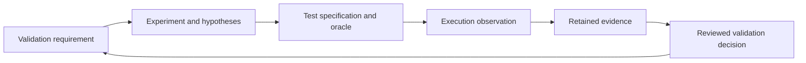

# Validation methodology

The Lab turns the [framework contract](../00-governance/validation-framework.md) into a readable investigation workflow. YAML records define engineering metadata. The [research register](../00-governance/technical-validation.md) preserves the original findings; [benchmarking standards](../06-benchmarking/benchmark-methodology.md) govern measurement and product acceptance. The [registry guide](../00-governance/validation-registry.md) explains migration and revision snapshots.



The arrows express traceability. A validation may need several experiments, an experiment may support several validations and a test may apply to only part of that shared scope. Relationships use IDs and revisions. A passing experiment, accepted validation and achieved product benchmark remain separate gates.

## 1. Establish the question and coverage

Start from the preserved finding, its evidence boundary and closure requirements. Use the [coverage matrix](validation-coverage.md) to identify mandatory experiments and applicable tests. An experiment must state a falsifiable hypothesis, its scope and exclusions, its method and unresolved prerequisites. Documentary investigation is appropriate for bibliography, topology or claim audits; it still requires a reproducible review procedure and retained evidence.

Keep the original research assessment separate from current engineering progress and disposition. For example, a role-only FDAP assessment does not mean an integration test has passed. An experiment shared by VAL-012 and VAL-013 cannot contribute an ownership-only test to the capacity requirement without an explicit scope relationship.

## 2. Define acceptance before execution

Each [test specification](test-register.md) declares setup, stimulus, expected outcome, independent oracle, execution method and required evidence. Fix supported configurations, identity/accounting rules, fixture values, numeric precision, error behavior and any measured budget before collecting acceptance results. An unresolved policy or budget is a prerequisite to resolve, not an invitation to choose a convenient result afterward.

Use oracles that do not call the production logic they verify. Small hand-checked fixtures, independent identity ledgers and separate reference evaluators help establish correctness. Model checking must declare explored bounds and invariants. Stress results describe executed schedules and supplement the safety argument. Instrumentation needs controls that demonstrate sensitivity and disclose overhead.

The [workload ledger](../06-benchmarking/workload-definitions.md) retains distinct MVP, reference, burst and local/remote profiles. Do not combine their thresholds into a new acceptance promise. Timing-sensitive results require a controlled environment; a shared CI build can establish compilation observations without establishing a latency target.

## 3. Prepare methods and environments

An unbound test has a specification but no prepared executable command or review entrypoint. Binding requires the concrete method and, for automated work, an implementation path. Before readiness, satisfy the experiment dependencies, prepare versioned fixtures and an applicable oracle, and declare the actual [environment](environment-profiles.md). A documentation generator does not inspect or fulfill those prerequisites.

Manual work needs versioned source editions, retrieval/archive details, a checklist and a named reviewer. Executable work needs pinned toolchains, dependencies, build features and reproducible commands. Performance work additionally needs hardware/topology, affinity, load, timing endpoints and sampling/measurement settings.

The register checker prevents experiments from advancing beyond `proposed` while mandatory methods remain unbound. A bound string alone does not establish that a source path exists, a command works or all contracts are approved; later readiness/execution tooling and review must establish those facts.

## 4. Record observations without replacing history

Create a distinct RUN record for each execution, pinned to experiment/test revisions and registry/implementation commits. Preserve exact commands or review procedures, actual inputs and hashes, seeds, instrumentation and environment deviations. Record each case as passed, failed, skipped or errored; preserve aborted runs and partial observations. Missing tests and tool failures cannot become an all-pass result.

An EVD manifest names retained artifacts with provenance, immutable references and SHA-256 digests. Large traces and datasets may be retained outside Git. Preserve unsuccessful observations alongside later improvements. The existing [evidence bundle contract](../06-benchmarking/evidence-and-traceability.md#proposed-evidence-bundle) and [engineering evidence map](../03-engineering/validation-and-traceability.md#requirement-to-executable-evidence-contract) define complementary content requirements.

The [execution register](execution-register.md) displays recorded outcomes. The [evidence register](evidence-register.md) displays manifests. Neither view silently verifies or approves its claims. The [Stage 8 runtime](execution-and-evidence.md) resolves historical definitions, captures bound methods, preserves observations and checks retained artifact content or an explicit local mirror. Review conclusions remain explicit.

## 5. Review a scoped conclusion

Assess every mandatory evidence and test obligation for the validation revision under review. Preserve limitations: sequential FIFO tests cannot establish concurrency safety, model results cannot exceed explored assumptions, and one workload cannot establish universal performance. Record unresolved findings and their impact on the conclusion.

A designated reviewer records a VDEC decision with rationale, supporting runs/evidence, applicability, review date and related architecture/specification actions. The [results view](validation-results.md) derives current disposition from the explicit decision reference. Pending, accepted, rejected, conditional and inconclusive conclusions follow the framework's [closure rules](../00-governance/validation-framework.md#dispositions-and-closure). A negative investigation can be useful while requiring a design change.

Architecture approval remains in the [decision register](../00-governance/decision-register.md) and ADR process. Conditional acceptance needs an explicit supported envelope and follow-up obligations; inconclusive results need a next investigation. A rendered page or successful documentation check grants neither reviewer approval nor release acceptance.

## 6. Revise and revalidate

Before advancing a VAL, EXP or TST revision, preserve the previous definition under `validation/revisions/` and record a dated reason. Update reciprocal references together. Runs, evidence and decisions retain their original identities; corrections use new records and supersession links.

Assess changes to invariants, dependencies/toolchains, contracts, workloads and hardware against the [revalidation rules](../00-governance/validation-framework.md#revalidation-and-applicability). Reopen affected conclusions for the changed scope while preserving their historical decision boundary. Documentation changes that alter no technical meaning need documentation checks; semantic changes require impact assessment.

## Documentation workflow and ownership

`scripts/generate_validation_docs.py` validates records and generates the Lab overview, coverage, registers, environment view, results and experiment pages. It updates only the marked Lab section in `mkdocs.yml`. The methodology is authored Markdown; edit it directly. The old `scripts/generate_validation_coverage.py` command remains a compatibility entrypoint for the same generator.

```bash
uv run --locked --extra docs --extra validation python scripts/generate_validation_docs.py
uv run --locked --extra docs --extra validation python scripts/check_documentation.py
```

The generator's `--check` mode verifies generated content and navigation without writing. The shared gate performs registry, Git-history and evidence/decision checks, generated-content checks, regressions, a strict build and rendered-link checks. [Automation and CI](automation-and-ci.md) documents workflow triggers and publication conditions. Prior governance coverage/test URLs retain anchors and link to the canonical Lab pages. The Lab section follows Rust reference; the other documentation sections retain their ordering. Stage 9 binds the first executable experiment, EXP-001; Stage 10 investigates EXP-002 overload behavior.
