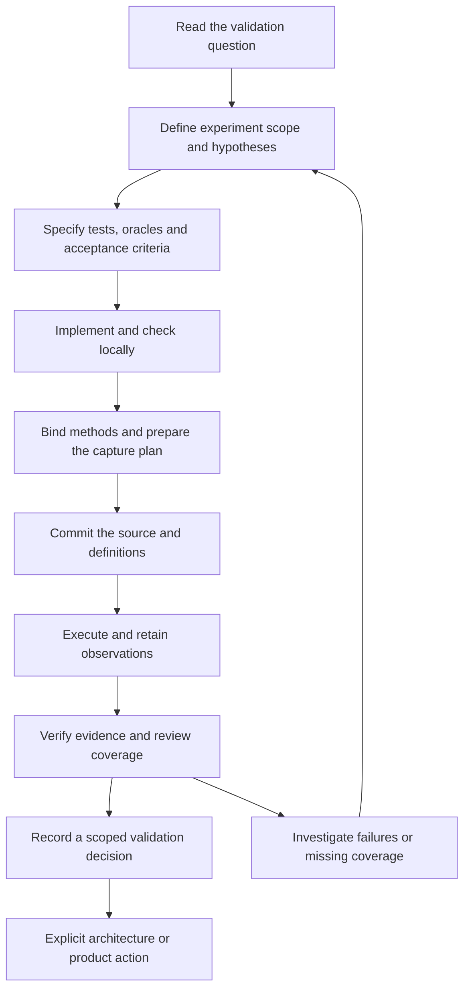

# Validation methodology

Use this workflow to implement and validate any experiment in the Technical Validation Lab. The sequence stays the same; the validation questions, experiment methods, test cases, inputs, environment and required evidence change. Executable tests, documentary reviews, model checking and performance measurements all need traceable observations and a scoped review.

The [framework contract](../00-governance/validation-framework.md) defines authority and closure rules. The [historical research register](../00-governance/technical-validation.md) preserves the original findings. YAML records define current engineering metadata; the generated Lab pages present those records. The [execution and evidence guide](execution-and-evidence.md) documents capture, storage, recovery and decision tooling.



**A passing test, a passing experiment run, an accepted validation and an achieved product benchmark are separate conclusions.** One validation can require several experiments. One experiment can contribute to several validations, while an individual test may apply to only part of that shared scope.

## What you maintain

| Record or file | Purpose | When it changes |
| --- | --- | --- |
| `validation/register/validations/VAL-*.yaml` | Technical question, preserved research provenance, closure evidence and mandatory coverage | When engineering requirements, coverage or lifecycle change; preserve original `origin` fields |
| `validation/register/experiments/EXP-*.yaml` | Hypotheses, scope, exclusions, dependencies, method and linked tests | When planning or revising the investigation, or recording its lifecycle |
| `validation/register/tests/TST-*.yaml` | Preconditions, procedure, expected result, independent oracle, evidence and execution binding | Before executing a new or changed test specification |
| Implementation and fixtures | Prototype, review checklist, model, input data or measurement harness | During development; identify the exact version used in each run |
| `validation/execution-plans/` | Automated capture configuration, exact commands, revisions, inputs and retention | Before a capture using that configuration |
| `validation/executions/` | Immutable RUN observations | Append a new record for each execution |
| `validation/evidence-manifests/` and retained artifacts | EVD provenance, supported scope and integrity-checked content | Append evidence; preserve earlier artifacts |
| `validation/decisions/` | VDEC reviewer conclusions for a validation revision | Append after explicit human review |
| Generated Lab views | Readable coverage, experiments, tests, runs, evidence and results | Regenerate from the records; do not edit their status tables manually |

Allocate stable IDs without reusing existing identities. References include revisions; directory names or Markdown links alone do not establish applicability. The [registry guide](../00-governance/validation-registry.md) and schemas under `validation/schemas/` define the exact fields.

## 1. Establish the question and coverage

Read the validation record, its original finding and its required closure evidence. Use the [coverage matrix](validation-coverage.md) to identify existing mandatory experiments and tests before adding work.

Write down:

- The technical question and why it matters.
- A falsifiable hypothesis: what observation would contradict it?
- Supported configurations and the boundary of the proposed conclusion.
- Exclusions and assumptions that this investigation will not establish.
- Which linked validation requirements each test will address.
- Dependencies, unresolved policies, approvals or budgets needed for the intended scope.

Choose a bounded investigation. A small prototype can investigate a provisional contract without claiming production adoption. If the result depends on a production policy or an approved budget, settle that prerequisite before collecting acceptance results. Preserve the original research finding even when the new prototype behaves differently.

**Output:** a versioned experiment definition with explicit validation applicability, hypotheses, scope, exclusions and dependencies. Keep the experiment `proposed` until its mandatory methods and prerequisites are prepared.

## 2. Define the contract, tests and acceptance criteria

Specify expected behavior before collecting acceptance observations. Depending on the experiment, fix capacity semantics, data identity, ordering, numeric precision, error behavior, recovery rules, workload shape, failure assumptions and measured budgets.

For every test, define the following in its TST record:

| Field | Question to answer |
| --- | --- |
| Preconditions | What source, state, configuration, environment and inputs must exist? |
| Procedure | What exact stimulus or review steps will be applied? |
| Expected result | What observable outcome constitutes a pass or a contradiction? |
| Independent oracle | How will the expected answer be obtained without repeating the implementation's logic? |
| Applicability | Which experiment hypothesis and validation requirement does this case address? |
| Execution method | Is this automated or manual, and how will it be invoked? |
| Required evidence | Which traces, ledgers, reports, source excerpts or measurements must be retained? |

Use separate reference models, immutable expected fixtures, hand-checked examples or independent calculations. For a queue, decide whether an insertion should succeed from a separate model's occupancy rather than from the queue's own fullness helper. Include boundary, invalid-input, rejection, recovery and repeated-operation cases relevant to the claim.

For model checking, declare assumptions, state-space bounds and invariants. For performance, declare the workload, timing endpoints, sample treatment and threshold before measurement. Keep the [workload profiles](../06-benchmarking/workload-definitions.md) distinct; evidence for one profile does not establish another profile's target.

Exploration can help design these specifications. Record it as exploration; do not retrospectively label a convenient observation as a predeclared acceptance pass.

**Output:** versioned tests with independent oracles, fixed acceptance criteria and mandatory coverage for the declared hypotheses and methods.

## 3. Prepare the implementation or review method

Implement the smallest artifact that can answer the question. Keep prototype choices and supported contracts explicit. Add instrumentation that can explain an unexpected result, including the observations immediately before a failure.

| Investigation type | Prepare before execution | Evidence and conclusion limits |
| --- | --- | --- |
| Executable correctness or safety | Versioned code and fixtures, build/dependency configuration, exact test entrypoints and independent models | Retain expected/actual observations and operation traces; finite schedules do not establish every interleaving |
| Documentary or architecture review | Source editions, retrieval/archive details, review checklist, comparison criteria and reviewer identity | Retain cited passages, reasoning and contradictions; a source assertion is not implementation evidence |
| Model checking | Versioned model, assumptions, properties, search bounds and tool configuration | Retain exploration results and counterexamples; conclusions stay within the model's assumptions and bounds |
| Performance or stress | Workload, hardware/topology, dependencies, affinity, load, clocks, sampling settings and instrumentation controls | Retain distributions and relevant resource observations; stress success alone is not a safety proof |

Use the [environment profiles](environment-profiles.md) and [benchmark methodology](../06-benchmarking/benchmark-methodology.md) to determine relevant details. Timing-sensitive acceptance requires a controlled environment. Ordinary shared CI can run correctness checks; it cannot establish a hardware-specific latency promise.

Record instrumentation overhead and controls where relevant. Preserve failed assertion prefixes, seeds and operation identities so failures can be reproduced. Avoid requiring the production implementation to compute its own expected answers.

**Output:** working implementation or documentary method, versioned fixtures and prepared evidence outputs.

## 4. Check locally and test the failure paths

Use the project's locked documentation/validation environment. From the repository root:

```bash
uv sync --locked --extra docs
```

Run the checks appropriate to the implementation language and investigation: formatting, compilation, static analysis, targeted correctness tests, model exploration or a trial of the review procedure. Consult the experiment's bound methods rather than assuming every experiment uses Cargo.

For example, EXP-001's Rust development checks are:

```bash
cargo fmt --all --check
cargo clippy --offline --locked --workspace --all-targets -- -D warnings
cargo test --offline --locked -p exp-001-spsc-queue
```

Inspect the reports as well as the exit status. Check that intended cases actually ran and that the harness waits for work to finish. Where useful, exercise deliberate failures in disposable copies: a violated invariant should fail a test, a missing test name must not produce an empty pass, and a compiler or tool failure must be distinguishable from a hypothesis contradiction. Recreate report files on each invocation so stale output cannot masquerade as fresh evidence.

Investigate failures without weakening the oracle to fit the implementation. If the contract or acceptance criteria need to change, revise the definitions explicitly before a new acceptance run. Local debugging commands do not automatically create registered RUN/EVD records.

**Output:** a runnable method with useful reports and understood failure behavior, ready for a traceable execution.

## 5. Bind methods and preserve definition revisions

For each automated TST record, set `execution_binding.state` to `bound`, identify its implementation path and specify its exact command. For manual work, bind the concrete review checklist or procedure. A command string alone does not establish that prerequisites are satisfied.

Before changing a VAL, EXP or TST definition:

1. Preserve the complete previous YAML at `validation/revisions/<registry>/<ID>/r<old-revision>.yaml`.
2. Increment its revision and append a dated revision-history entry with actor and reason.
3. Update affected reciprocal references together, preserving snapshots for the other definitions that change.
4. Preserve original research provenance and existing historical records.

A code-only change still requires a new implementation commit and new observations; it does not automatically require rewriting an unchanged test definition. Lifecycle changes need legal transitions and appended lifecycle history rather than an invented result. See the [framework state model](../00-governance/validation-framework.md#state-and-outcome-model).

All mandatory methods must be bound before an experiment advances beyond `proposed`. Move it to `ready` only when its contract, fixtures, oracles, dependencies and environment are prepared. Record subsequent `running`, `reviewing` and `completed` transitions when those milestones are reached. Capture does not update these states automatically. A validation with several mandatory experiments may remain `planned` while one experiment is ready or has observations.

**Output:** consistent revision-pinned definitions and concrete bindings, with readiness justified by the actual prerequisites.

## 6. Prepare the capture plan and retention

For automated execution, prepare a schema-valid plan under `validation/execution-plans/`. The existing EXP-001 plan is a worked example; adapt its values and commands to the investigation instead of copying its assumptions.

The plan must identify:

- Experiment and selected test IDs/revisions, registry commit, implementation commit and working directory.
- Exact argument arrays matching the bound methods, assertion-failure exit codes and required artifact paths.
- A toolchain probe, configuration, explicit environment variables and deviations.
- Versioned input paths, dependency lockfiles, seeds and instrumentation.
- Timeout, retention policy and repository artifact-size limit.

Use `HEAD` only where the plan schema allows it; capture resolves it to an exact commit before execution. Record actual host/toolchain observations and configuration deviations. Keep secrets out of plan metadata and captured environment variables.

Use repository retention for suitably small artifacts. Large outputs remain in a separate run bundle and need accessible retained storage or a mirror. Plan access and retention before running; an artifact manifest is insufficient if the referenced content later disappears. CI upload retention is temporary.

**Output:** a complete capture plan and a storage arrangement for both successful and unsuccessful observations.

## 7. Check definitions and commit the source boundary

Before the source checkpoint, validate records, inspect history changes and regenerate the Lab:

```bash
cargo lab registry check --require-tests
cargo lab history check
cargo lab docs generate
```

Review and commit the intended source, fixtures, lockfiles, definitions, bindings, plan and generated views. Check the working tree with:

```bash
git status --short
```

Real capture requires clean committed source. New ledger/artifact additions have explicit exclusions, described in the [source boundary](execution-and-evidence.md#source-and-readiness-boundary). Do not treat arbitrary uncommitted changes as reproducible source.

The evidence verifier resolves capture-plan definitions from Git. A newly introduced revision or plan may therefore need this source commit before the complete gate can pass. Once committed, run the shared gate:

```bash
cargo lab check
```

Freeze source, definitions and inputs while capturing. A tracked-source or input mutation during execution prevents a positive result. Commit any intended lifecycle changes before the next capture rather than editing metadata during a run.

**Output:** a checked, committed source boundary that the run can identify exactly.

## 8. Execute and retain every outcome

Choose a new, unused RUN identity for each execution. The following example uses the existing EXP-001 plan; substitute the prepared plan and a fresh run ID for your experiment:

```bash
cargo lab execution capture \
  --plan validation/execution-plans/EXP-001.yaml \
  --committed-plan \
  --run-id RUN-exp001-manual-001
```

Do not reuse that example identity if it is already reserved or registered. Selected automated cases execute in the pinned experiment's test order. The runner records actual commands, per-case outcomes, environment, inputs, lockfile hashes and source commits. It retains logs and declared outputs, writes evidence manifests and registers the execution after verification.

| Observation | Meaning and action |
| --- | --- |
| `passed` | The declared procedure satisfied its assertions; still review the oracle and coverage |
| `failed` | An assertion contradicted the expected behavior; preserve the inputs and trace |
| `error` | A build, tool, timeout, missing artifact or other execution problem prevented a valid positive observation |
| `skipped` | A declared case was not attempted; retain the reason |
| Aggregate `incomplete` | Required case accounting includes skipped/unperformed work; it cannot become an all-pass result |
| Aggregate `aborted` | Execution was interrupted; preserve available observations and describe what is known |

Capture returns nonzero for unsuccessful/incomplete outcomes while retaining finalized observations. Inspect the reserved bundle before retrying; use a new identity for a new execution. Forced termination or runner loss can leave only partial output. Do not reconstruct an all-pass result from absent observations. Use the [interrupted-publication procedure](execution-and-evidence.md#manual-observations-and-interrupted-publication) only with complete verified staged manifests.

For documentary work, perform the bound checklist and prepare a schema-valid RUN plus EVD manifests and retained review artifacts. Record manual outcomes without fabricated commands or exit codes. Import them using `cargo lab execution import`, as documented in that same guide. The automated capture command is not a substitute for a manual review.

**Output:** a new immutable execution and retained evidence, including failures and limitations.

## 9. Verify evidence, publish views and inspect the observations

Run:

```bash
cargo lab evidence verify
cargo lab docs generate
cargo lab check
```

Verification checks pinned definitions, artifact sizes/digests, input and lockfile hashes, command bindings, scope and outcome accounting. External/bundle artifacts require accessible content or an explicit local mirror; missing content must not be silently skipped.

Review the [execution register](execution-register.md), [evidence register](evidence-register.md), experiment page and underlying reports. Confirm that the intended cases, inputs, configuration and source versions were exercised, then compare actual observations with the independent expected results. A process exit of zero cannot establish that the oracle or the domain coverage is adequate.

Commit the reviewed RUN/EVD records, repository-retained artifacts and generated views so Git history protects their append-only boundary. Store larger bundles in the declared retained location. Do not edit a historical record to fix a mistake; append a correction with a new identity and appropriate supersession relationship.

**Output:** retrievable, integrity-checked observations with readable Lab views and preserved history.

## 10. Review hypotheses and validation coverage

Assess each hypothesis within the executed bounds. Record supporting and contrary observations, unresolved findings, assumptions and exclusions. Distinguish a limited observation from a general proof: sequential FIFO tests do not establish concurrent publication safety, and one workload does not establish universal performance.

For every linked validation, compare its mandatory experiments, tests and evidence requirements with the applicable observations. A shared experiment's ownership-only test cannot satisfy an unrelated capacity obligation. Retain failed observations and explain their resolution rather than selecting only convenient passes.

The current positive-decision verifier requires selected supporting observations to share the applicable registry and implementation boundary. If required experiments were run against different commits or stale definitions, prepare a coordinated committed package and rerun the required cases; do not combine incompatible observations into a current acceptance claim.

An experiment can reach `completed` after its required investigation and conclusion are reviewed, including a supported negative conclusion. Completion does not mean every hypothesis was confirmed, and it does not close a validation whose other obligations remain incomplete.

**Output:** a scoped experiment conclusion and an explicit account of satisfied, missing and invalidated validation obligations.

## 11. Record a human validation decision and related actions

When a validation is ready for review, prepare a package. These IDs and the output filename are examples; choose unused identities and a new draft path:

```bash
cargo lab review prepare \
  --validation VAL-012 --decision-id VDEC-001 --output /tmp/VAL-012-review.yaml
```

The package is an unapproved draft. The designated reviewer selects applicable runs/evidence and completes rationale, requirement-by-requirement evidence assessment, unresolved findings, implementation/workload/environment limits, follow-up, identity and review time. Set `draft: false` only after that review.

Check the completed candidate without registering it:

```bash
cargo lab review check \
  --candidate /tmp/VAL-012-review.yaml
```

Accepted or conditional conclusions require the declared mandatory coverage and valid supporting evidence. Conditional acceptance needs an explicit supported envelope and follow-up; it cannot silently waive mandatory tests. Rejection records what was disproven and the resulting engineering action. Inconclusive review records what is unresolved and the next investigation; it does not close the validation.

After the named human review, an operator can explicitly add `--register-reviewed` to the check command to append the decision. The validation must already be in `reviewing`. Registration does not select the current decision or close the validation automatically: update the validation's current/prior decision references and legal lifecycle history explicitly, regenerate views and run the shared gate. The [results view](validation-results.md) derives disposition from those records.

Architecture adoption remains a separate action in the [decision register](../00-governance/decision-register.md) and ADR process. A reviewed validation does not independently approve a product release or architecture choice.

**Output:** a traceable reviewer decision, explicit current disposition and assigned engineering/architecture follow-up.

## 12. Revise and revalidate when the applicability changes

Assess changes to code, invariants, contracts, dependencies, toolchains, workloads, hardware and supporting evidence against the [revalidation rules](../00-governance/validation-framework.md#revalidation-and-applicability). Record the affected requirements, prior decision, reason and selected investigation work.

Preserve old definitions and observations. Reopen affected closed validations when the changed scope is no longer covered, retaining historical decisions and their operating boundaries. A completed experiment needing further investigation starts a new revision in `proposed`. A new passing run does not automatically replace a reviewer-selected decision.

Documentation edits that change no contract or claim need documentation checks. Changes to thresholds, oracles, failure models or supported configurations need technical impact assessment and the corresponding investigation.

**Output:** an explicit revalidation plan with historical evidence intact.

## Worked example: EXP-001

The workflow is **define the question → specify tests → implement → run locally → capture evidence → review what the evidence supports**.

EXP-001 already has an implementation and a recorded run. The steps below explain how you would do the work yourself, using the existing files as examples.

1. **Read the validation question before writing code.**

    Start with [VAL-012](https://github.com/mbellary/chronoshft/blob/main/validation/register/validations/VAL-012.yaml), then [EXP-001](https://github.com/mbellary/chronoshft/blob/main/validation/register/experiments/EXP-001.yaml).

    EXP-001 asks two specific questions:

    - When the queue is full, does insertion fail before changing unread entries?
    - Does every accepted event come out exactly once, in FIFO order, including after wraparound?

    Its scope is sequential behavior. Concurrency proof belongs to EXP-003; sustained overload behavior belongs to EXP-002.

2. **Write the contract that the implementation must satisfy.**

    Fix these choices before running tests. EXP-001’s [prototype contract](https://github.com/mbellary/chronoshft/blob/main/experiments/exp-001-spsc-queue/README.md) specifies:

    - Capacity counts individual events.
    - Every integer capacity from 1 through 4096 is supported.
    - All N slots are usable.
    - Zero and oversized capacities return explicit errors.
    - A full insertion returns the original event without changing unread entries.
    - An empty removal returns `None`.

    These choices define what “correct” means. Changing them after seeing a failure requires an explicit specification revision.

3. **Define the tests and their independent expected results.**

    Read TST-001 through TST-004 in the [generated experiment page](experiments/EXP-001.md).

    | Test | What you exercise | How you determine correctness |
    |---|---|---|
    | TST-001 | Insert/remove sequences and empty transitions | Compare accepted and consumed identity lists exactly |
    | TST-002 | Fill to N, attempt extra inserts, drain and reuse | Verify rejected events are returned and unread events remain intact |
    | TST-003 | Repeated partial drains, refills and wraparound | Compare every operation with an independent `VecDeque` model |
    | TST-004 | Zero, minimum, non-power-of-two, maximum and oversized capacities | Compare constructor outcomes with the written capacity contract |

    The independent model matters. For example, determine whether insertion *should* succeed from the reference deque’s length—not from the queue’s own `is_full` calculation.

4. **Implement the smallest prototype that answers those questions.**

    The implementation is in [lib.rs](https://github.com/mbellary/chronoshft/blob/main/experiments/exp-001-spsc-queue/src/lib.rs).

    Its structure is:

    - Preallocate N slots.
    - Maintain read position, write position and occupied count.
    - Check fullness **before** assigning an event to a slot.
    - Advance positions within the bounded slot range.
    - Remove each event by taking it from its slot.
    - Expose one producer and one consumer endpoint.

    This prototype uses a mutex and safe Rust. That is sufficient to investigate the declared sequential behavior; performance and concurrent publication require their own investigations.

5. **Implement the tests and retain useful observations.**

    See [queue_contracts.rs](https://github.com/mbellary/chronoshft/blob/main/experiments/exp-001-spsc-queue/tests/queue_contracts.rs).

    Each test should record enough information to explain a failure:

    - Capacity and input identities.
    - Operations attempted.
    - Actual and independently expected results.
    - Accepted and consumed identities.
    - Seed and wraparound counts where applicable.

    Reports should retain the observed prefix when an assertion fails. A single final “passed” message would provide much less diagnostic evidence.

6. **Run development checks and investigate failures.**

    From the repository root:

    ```bash
    cd /home/mbellary/work/projects/chronoshft

    uv sync --locked --extra docs

    rustc --version
    cargo --version

    cargo fmt --all --check

    cargo clippy --offline --locked \
      --workspace \
      --all-targets -- -D warnings

    cargo test --offline --locked \
      --workspace \
      -p exp-001-spsc-queue
    ```

    To exercise one case through the native development helper:

    ```bash
    cargo lab experiment run-case capacity_before_write
    ```

    The runner distinguishes assertion failure from build/tool failure and checks that the requested test actually exists. The current capture plan records native Rust bindings and the root Cargo.lock; historical runs retain their original commands and source commits. Changing a binding requires its explicit versioned update, rather than substituting the development command during capture.

    At this point, you are developing and debugging. These commands alone do **not** create a registered RUN record.

7. **Bind the implementation and prepare the capture plan.**

    Each TST record must identify its source file and exact executable command. EXP-001 must reference those test revisions and be ready for execution.

    The [capture plan](https://github.com/mbellary/chronoshft/blob/main/validation/execution-plans/EXP-001.yaml) then declares:

    - Experiment and test revisions.
    - Implementation and registry commits.
    - Exact commands and expected output files.
    - Input files and dependency lockfile.
    - Seed, environment, timeout and retention policy.
    - Exit codes representing assertion failures.

    If you change an experiment or test definition, preserve its previous YAML under `validation/revisions/`, increment its revision and update affected reciprocal references. A code-only change still needs a new implementation commit and a new run.

    Check the definitions and regenerate their views:

    ```bash
    cargo lab registry check \
      --require-tests

    cargo lab history check

    cargo lab docs generate
    ```

8. **Commit the source, definitions and plan, then capture a real run.**

    Review and commit your intended changes. The capture tool requires clean, committed source so the evidence identifies exactly what was tested.

    Confirm the working tree is clean:

    ```bash
    git status --short
    ```

    Then run capture with a **new, unused RUN identity**:

    ```bash
    cargo lab execution capture \
      --plan validation/execution-plans/EXP-001.yaml \
      --committed-plan \
      --run-id RUN-exp001-manual-20261015-001
    ```

    Choose a different ID if that one already exists. Never reuse or overwrite a previous run.

    Capture creates the run record, evidence manifests, retained outputs and source/environment references. Failed observations are retained too. If you fix a failure, commit the fix and capture another run.

9. **Verify the evidence and examine the results yourself.**

    ```bash
    cargo lab evidence verify

    cargo lab docs generate

    cargo lab check
    ```

    Then inspect the registered results and retained reports. Check that:

    - All four intended cases ran.
    - None were skipped or replaced by a tool error.
    - The expected capacities, identities and seed were used.
    - The comparisons support the hypotheses.
    - The recorded source and environment match the intended experiment.

    Commit the new run, manifests, repository-retained artifacts and generated views after review. Historical records remain unchanged.

10. **Evaluate coverage before making a validation decision.**

    Ask: **“What does this run establish, and what remains unanswered?”**

    For the existing EXP-001 run:

    - Four tests passed within their sequential scope.
    - VAL-012 has passing observations for **4 of 11 mandatory tests**.
    - Overload policy and publication obligations remain incomplete.
    - VAL-013’s ownership tests were not executed.
    - Neither validation is accepted.

    When sufficient evidence is available, prepare a human review package:

    ```bash
    cargo lab review prepare \
      --validation VAL-012 \
      --decision-id VDEC-001 \
      --output /tmp/VAL-012-review.yaml
    ```

    This creates an unapproved draft. A reviewer must assess coverage, evidence, limitations and the proposed disposition. EXP-001 passing by itself is insufficient to accept VAL-012.

The reusable distinction is: **tests check behavior; a captured run records observations; validation review decides whether those observations satisfy the original obligation.**

## Completion checklist

Before calling the investigation complete, confirm:

- Scope, hypotheses, test criteria and exclusions were declared before acceptance execution.
- Methods, fixtures, oracles and relevant environments were prepared and revision-pinned.
- The intended cases ran, with explicit failures, errors, skips and interruptions.
- Evidence is retained, accessible and integrity-checked; unsuccessful observations remain available.
- Conclusions explain their bounds and applicability to each linked validation.
- Missing mandatory obligations remain visible; a run pass has not become an automatic validation acceptance.
- Required reviewer decisions, lifecycle changes and architecture actions are explicit and traceable.
- Generated views, documentation and selected technical checks pass.

## Rust tooling migration

The investigation workflow above remains the same while repository-owned tooling
moves from Python to Rust. The [migration contract](rust-migration.md) documents
the compatibility fixtures, stage boundaries and CLI. Stages 2–7 supply native
registry, history, evidence, generation, capture/import, experiment and reviewer
commands, plus the shared `cargo lab check` gate used locally and in CI. Rust tests
cover the frozen legacy regression inventory. Stage 8 retires custom Python tools
and regression modules, versions native capture bindings, and consolidates the Cargo
workspace. Original reference source and fixture hashes remain available in Git. MkDocs and Material continue to build and publish this site.

## Documentation workflow and ownership

This methodology is authored Markdown; edit it directly. `cargo lab docs generate` generates the Lab overview, coverage, registers, environment view and experiment pages, and updates the marked Lab navigation section in `mkdocs.yml`. It preserves this page. Custom Python generators are retired; the governance compatibility pages keep their existing URLs and anchors.

The shared gate checks registry/history/evidence consistency, generated views, regressions, the strict MkDocs build and rendered local links. It does not replace experiment-specific capture or human review. Some regressions exercise experiment code in disposable fixtures without producing registered observations. See [Automation and CI](automation-and-ci.md) for the publication boundary and [Execution and evidence](execution-and-evidence.md) for runtime details.
